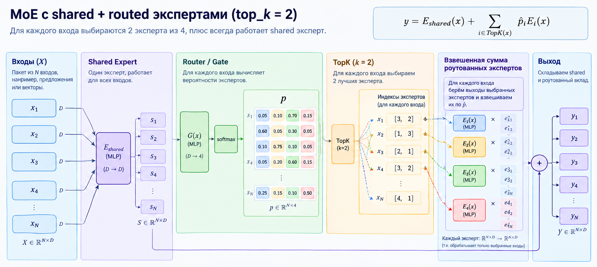

## Архитектура MoE-слоя

### Экземпляр одного эксперта (_expert_block(...))

Для батча из \(N\) объектов:

$$ Y_s = \operatorname{LayerNorm}(\operatorname{ReLU}(XW_s+b_s)), \quad \text{где } X \in \mathbb{R}^{N \times D},\ W_s \in \mathbb{R}^{D \times O},\ Y_s \in \mathbb{R}^{N \times O},\ O = \text{out\_channels} $$

### MoEGate — router

`gate_input` в этом файле нужен для разделения двух понятий:

x — данные, которые реально проходят через experts;
gate_input — данные, по которым router решает, какой expert выбрать, gate_input как отдельные геометрические признаки для маршрутизации.
Один и тот же gate_input используется как routing signal на всех слоях, тогда как x последовательно преобразуется от слоя к слою.

Размер скрытого слоя router:

$$ H = \max(D/\text{MOE\_GATE\_HIDDEN\_RATIO},\; 2E,\; 16) $$

На входе:

$$ \tilde G = \operatorname{LayerNorm}(G), \quad \text{где } G \in \mathbb{R}^{N\times D}$$

Для весов линейных слоёв используется инициализация Ксавьера, bias инициализируются нулями. bias последнего слоя - нормально распределенные случайные величины, чтобы сломать симметрию.

Первый Linear:

$$ H_r = \operatorname{ReLU}(\tilde G W_1+b_1), \quad \text{где } W_1\in\mathbb{R}^{D\times H},\ H_r\in\mathbb{R}^{N\times H} $$

Затем второй Linear, получаем логиты:

$$ L = H_rW_2+b_2, \quad \text{где } W_2\in\mathbb{R}^{H\times4},\ L\in\mathbb{R}^{N\times4}$$

Softmax:

$$ P_{ij} = \frac{\exp((L_{ij}+\epsilon)/T)} {\sum_{e=1}^{4}\exp((L_{ie}+\epsilon)/T)}, \quad P\in\mathbb{R}^{N\times4},\ \sum_{j=1}^{4}P_{ij}=1 $$

где:

i — объект, . 
j — expert,  
T = MOE_ROUTER_TEMPERATURE,  
ϵ = MOE_ROUTER_NOISE  $$ \epsilon\sim N(0,\sigma^2) $$
  

### TOP-k

Применяется MOE_TOP_K, и веса выбранных экспертов **повторно нормализуются**:

$$ \hat P_{ij} = \frac{P_{ij}} {\sum_{k\in TopK}P_{ik}} $$

## Объяснение утилитарных функций

### Switch Transformer / GShard auxiliary load-balancing loss

Дополнительный loss, который заставляет нагрузку распределяться более равномерно, чтобы избежать ситуации, когда router постепенно научился отправлять почти всё одному эксперту, суммируется по слоям.

$$ L_{balance} = E\sum_i f_iP_i $$

где:

\(E\) — число экспертов,  
\(f_i\) — фактическая доля этого expert, нормализованная на top_k,  
\(P_i\) — средняя вероятность этого expert.  

## Метрики

***expert_usage*** - как часто каждый expert выбирался, ожидается равномерное распределение, но нужно учитывать равномерность исходного датасета. Усредняется по слоям.
***expert_usage_spread*** - насколько отличается самый используемый эксперт от самого неиспользуемого  
***router_entropy***: 

для 4 experts максимум:

$$ H_{max}=\ln 4 \approx 1.386 $$

Минимум стремится к:

$$ H_{min}=0 $$

здесь энтропия вычисляется по полному softmax до top-k, не по top_k_probs, усредняется по слоям.

## Изменения в GCN и PairCls_GCN

В GCN и PairCls_GCN теперь вместо MLP используются MoEMLP.

### GCN

Для mlp_glb:

Что обрабатывают experts:
skip_features = [x1, x2, x3]       → 832

Что смотрит Router:
gate_input = [x, x1, x2, x3]        → 835

То есть Router принимает решение на основании геометрии и всех трёх уровней GCN-признаков, а сами experts обрабатывают только skip_features.

Аналогично с mlp_transform_body.

                       
x ──> GCU1 ──> GCU2 ──> GCU3             
       │         │        │               
       └─────────┴────────┘               
                    │                     
                    ▼                     
                    │
                  CONCAT        
                    │                     
                    ▼                     
На этом этапе модель как раз пытается получить глобальное высокоуровневое представление меша, поэтому router имеет смысл дать всю доступную multi-scale информацию.
              ┌─────────────┐             
              │   MoE #1    │◄──── [x,x1,x2,x3] 
              │ 832 → 1024  │             
              └──────┬──────┘             
                     │                    
                     ▼                    
               global max pool            
                     │                    
                     ▼                    
             global feature 1024          
                     │                    
                     ▼                    
        [global, x, x1, x2, x3]            
                     │
                     |                    
                  CONCAT
                     |                    
                     ▼         
router определяет тип геометрии на основе информации низкого уровня, а experts уже обучаются по-разному обрабатывать этот тип.           
              ┌─────────────┐             
              │   MoE #2    │◄──── [x,x1]
              │1859 → 1024  │             
              └──────┬──────┘             
                     │                    
                     ▼                    
              ┌─────────────┐             
              │   MoE #3    │◄──── [x,x1]
              │1024 → 256   │             
              └──────┬──────┘             
                     │
                     ▼
                  Dropout
                     │
                     ▼
                Linear → out

### PairCls_GCN

joints_pair, исходное, интерпретируемое геометрическое описание пары, используется роутером для выбора экспертов. Экспертам на вход подаётся pair_feature, 256-мерное обученное нелинейное embedding-представление этой геометрии.

## Изменения по коммитам в ветке

| Аспект | f929f62 (Add cuda arg) | cd9debe (Moe finetune_v1) | 260c8f4 (Moe finetune_v2) |
|---|---|---|---|
| Кол-во экспертов (Joint/Mask) | 4 | 6 | 4 |
| Top-K (Joint/Mask) | 2 | 1 | 2 |
| Router Noise | 0.1 | 0.01 | 0.0 |
| Router Temperature | — | — | 0.5 |
| Shared Expert | — | — | Да |
| Гейт | Линейный слой | MLP (MoEGate) | MLP + LayerNorm + симметрия-брейкер |
| Эксперты (BoneNet) | 4 / 2 | 8 / 1 | 4 / 2 |
| Сбор router_entropy | — | Да | Да (унаследовано) |
| Ключевая идея | Выбор GPU | Углублённая специализация через MLP-гейт и шум | Стабилизация через shared expert и температуру |